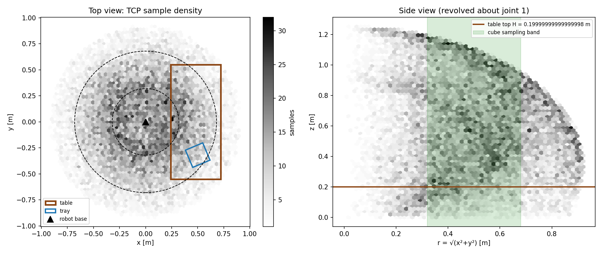
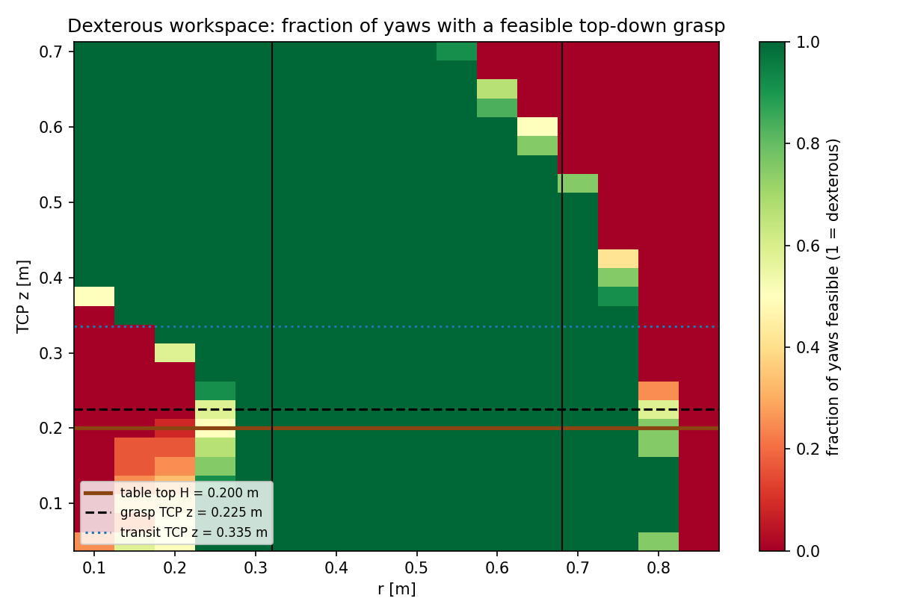
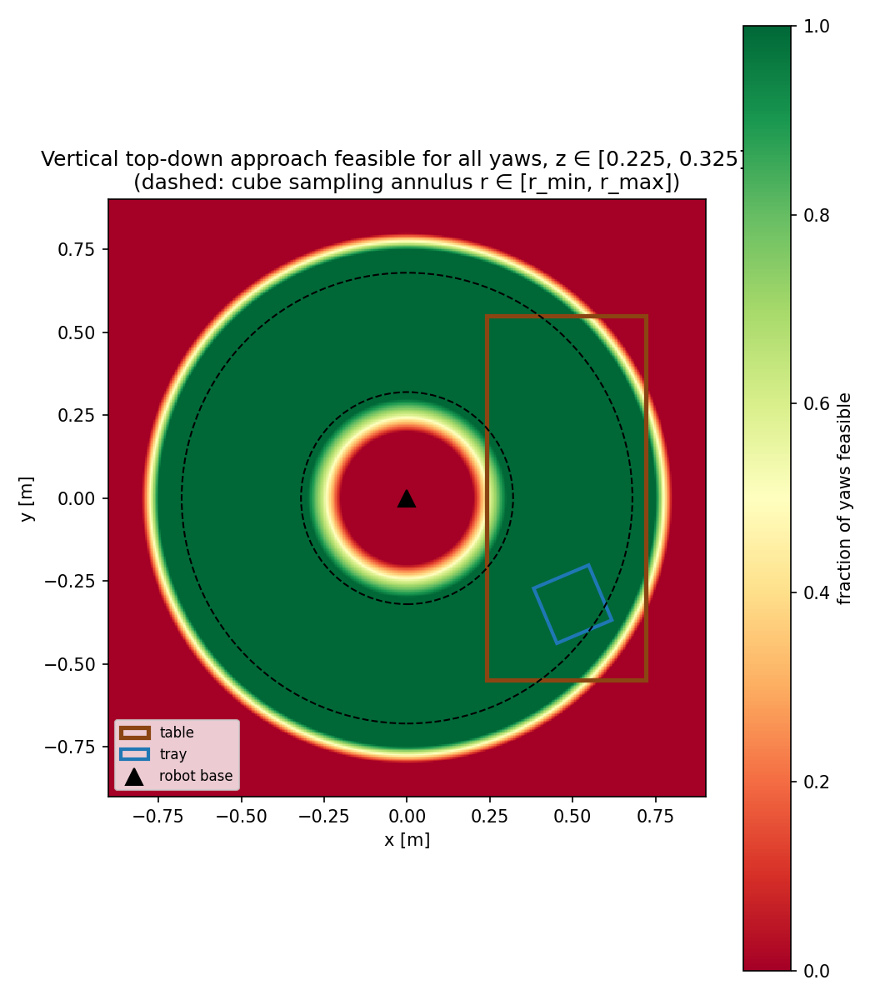

# Tutorial 4 – Pick and Place in MuJoCo with IK (Franka Emika Panda)

**Name / Roll no.:** ⟨…⟩  **Repository:** ⟨GitHub link⟩  **Video:** ⟨link⟩ (shown at 1.5× real time; physics unchanged)
**IK library:** Mink – https://github.com/kevinzakka/mink

> Items marked ⟨…⟩ come from your own runs (`results/`). Delete this note before submitting.

## 1. Introduction and goals

A 7-DoF Franka Emika Panda with a parallel-jaw gripper must pick a 5 cm cube placed at a random
position and yaw on a table and drop it into a tray. We (i) analyse the task and dexterous workspaces
and size the table from them, (ii) build a randomised, fully logged episode pipeline, (iii) solve IK with
the off-the-shelf library Mink, and (iv) replace it with our own Damped-Least-Squares (DLS) and
Quadratic-Programming (QP) IK, comparing all three on identical seeds.

## 2. Methods

### 2.1 Environment and robot model
The starter `franka_scene.xml` referenced `mjx_panda.xml`, arena and plate files that were not provided,
so the Panda is rebuilt in `pick_place_scene.xml` from Franka's official kinematics (the body offsets and
joint limits of MuJoCo Menagerie's `panda.xml`), with capsule links and approximate link inertias.
Joint limits are asymmetric (e.g. q₄ ∈ [−3.07, −0.07], q₆ ∈ [−0.02, 3.75], q₇ ∈ ±2.90 rad), so the home
pose is the classic ready pose q = (0, −π/4, 0, −3π/4, 0, π/2, π/4), which points the TCP straight down
at (0.31, 0, 0.52) m. The gripper is a parallel jaw (two slide joints, position actuators kp = 800 with a
30 N limit, 40 mm high-friction pads) mounted 0.107 m from the flange with the Panda hand's 45° offset.

*Control:* τ = qfrc_bias + K_p(q* − q) + b·q̇*, with K_p = (400, 400, 400, 400, 100, 100, 60) N·m/rad,
joint damping b = (40, 40, 40, 40, 8, 8, 5) N·m·s/rad as the implicitly integrated D-term, and the real
Panda torque limits (±87 N·m on joints 1–4, ±12 N·m on joints 5–7). The simulation uses Δt = 1 ms, an
elliptic friction cone and the noslip solver. These contact settings come from an ablation on the HEAL
version, where coarser settings caused in-hand slip.

### 2.2 Workspace analysis and table design
*Task workspace:* TCP positions from 30 000 uniformly sampled joint vectors within the limits (Fig. 1),
giving a maximum reach of r = 0.92 m and z ∈ [0, 1.25] m. *Dexterous workspace:* a position counts as
dexterous if a top-down grasp is feasible for all 12 tested yaws in [−π, π). Joint 1 rotates the arm
about the world z-axis, so we scan an (r, z) grid (16 × 27) with DLS-IK, using continuation between heights
and random restarts inside the joint limits (Fig. 2).

Result: every yaw is feasible for r ∈ [0.30, 0.70] m from z = 0.05 m up to about 0.55 m. Near the base
(r < 0.25 m) the Panda cannot point straight down at low heights, and beyond r ≈ 0.75 m it runs out of
reach. Compared with the HEAL arm (r ≤ 0.50 m, z ≥ 0.25 m) the dexterous region is much larger, thanks to
the redundant 7th joint and longer links.

The vertical approach column of an episode spans the grasp height H + 0.025 m up to the transit height
H + 0.135 m, and the whole column must be dexterous. That gives a feasible table height of
**0.025 m ≤ H ≤ 0.415 m**; we chose **H = 0.20 m**, near the middle, for margin on both sides.

| Parameter | Symbol | Value | Rationale |
|---|---|---|---|
| Table length | L | 0.48 m (x = 0.24 … 0.72) | Front edge clears the base; far corners (r ≤ 0.91 m) inside the 0.92 m task reach |
| Table width | W | 1.10 m (y = ±0.55) | Covers the dexterous annulus on both sides of the robot |
| Table height | H | 0.20 m | Approach column z = 0.225 … 0.335 m fully dexterous; feasible range 0.025–0.415 m |
| Cube sampling | r | [0.32, 0.68] m, yaw ∈ [−π, π) | 2 cm inside the fully dexterous band |
| Tray | — | centre (0.50, −0.32), r = 0.59 m, yaw 0.4 rad | Inside the dexterous band at the place height (0.243 m) |

### 2.3 Episodes and collision avoidance
For episode i (seed = i), x and y are drawn uniformly on the table with a 5 cm edge margin. Samples outside
r ∈ [0.32, 0.68] m, or inside the tray keep-out box, are rejected; yaw is uniform in [−π, π). The same
seeds are used for all three methods. The phases are: approach (TCP at transit height above the cube) →
descend → close → lift → transit → lower into tray → open → retreat. Each phase is a straight Cartesian
line with minimum-jerk timing, discretised at 50 Hz, and IK is solved at every knot, warm-started from the
previous one.

The grasp yaw is the cube-symmetric option (k·90°) closest to the current wrist yaw, with the other three
as fall-backs. This matters on the Panda, because joint 7 only turns ±166°.

*Cube–gripper–tray collision avoidance:*
1. The transit height keeps the cube bottom and fingertips 5 cm above the tray walls.
2. After the lift, the cube's yaw relative to the gripper is re-measured, and the place yaw aligns the cube
   with the rotated tray, using the option that needs the least wrist rotation.
3. Before executing, the planner checks that the cube corners and the opened pads fit inside the tray
   (5 mm margin) and predicts the transit clearance from FK; if a check fails, it raises the transit
   height or tries another yaw.
4. During execution, contacts are monitored and `mj_geomDistance` clearances are logged.

### 2.4 IK methods
All three share the pose error e = [p_t − p; ε_ω], where ε_ω = 2·Log(q_t ⊗ q_c⁻¹) with hemisphere
correction, computed as θ = 2·atan2(‖v‖, w) for accuracy at small angles. They also share ẋ_d = K e with
K·Δt = 0.8, the tolerances (1 mm, 0.01 rad), the iteration budget (200) and the rest posture q_home.

* **Mink:** `FrameTask` on the TCP site, `PostureTask` (cost 10⁻⁴), `ConfigurationLimit`, `VelocityLimit`
  (2 rad/s), with the DAQP solver. A posture cost of 10⁻² biased the solution away from the target and
  caused failed grasps (found on HEAL).
* **DLS:** q̇ = (JᵀJ + λI)⁻¹Jᵀẋ_d + (I − (JᵀJ + λI)⁻¹JᵀJ)·α(q_home − q), with λ = 10⁻³ and α = 0.005.
  On the 7-DoF Panda this null-space term is what selects the elbow configuration. Joint limits are only
  enforced by clipping, counted as limit hits.
* **QP:** min ½ΔqᵀHΔq + cᵀΔq s.t. GΔq ≤ h, with H = (2/Δt²)(JᵀJ + (λ + μ)I) and
  c = −(2/Δt)Jᵀẋ_d − (2μ/Δt)q̇_null. G = [I; −I] encodes the joint limits, the per-iteration step bound
  and the trajectory bound |q + Δq − q_prev| ≤ v_max·Δt_knot.
  **Note:** expanding the tutorial's cost gives c = −(2/Δt)Jᵀẋ_d, not −(1/Δt); the latter halves every
  step. This is verified in `tests/test_ik_math.py`.

*Observed during development:* with targets whose yaw requires turning joint 7 the "long way" from the
home pose, DLS pins q₇ at its limit and stalls (about 290 clipped iterations out of 300). The same
positions solve immediately at a cube-symmetric yaw, which motivates the yaw fall-back above.

## 3. Results (25 episodes per method, identical seeds)

⟨paste `results/comparison/summary_table.md`⟩

| Method | Success | Plan time / ep [s] | IK iters / knot | Min clear cube–tray [m] | Limit hits | Vel. violations |
|---|---|---|---|---|---|---|
| Mink | ⟨⟩ | ⟨⟩ | ⟨⟩ | ⟨⟩ | ⟨⟩ | ⟨⟩ |
| DLS | ⟨⟩ | ⟨⟩ | ⟨⟩ | ⟨⟩ | ⟨⟩ | ⟨⟩ |
| QP | ⟨⟩ | ⟨⟩ | ⟨⟩ | ⟨⟩ | ⟨⟩ | ⟨⟩ |

*Stress test (v_max = 0.8 rad/s):* ⟨paste `results/stress_comparison/summary_table.md`⟩

Paired tests (`stats.md`): ⟨Wilcoxon / McNemar p-values⟩

*Kinematic pre-check (no physics):* planning all 25 seeds succeeded with both DLS and QP (25/25 each),
with 0 velocity violations, 0 joint-limit hits, about 0.9 IK iterations per knot and a peak planned joint
speed of 1.18 rad/s.

## 4. Failure analysis and mitigations
⟨failures from your Panda runs with screenshots from `results/logs/<ik>/failures/`, or "none" plus the stress-test failures⟩

| Category | Cause | Mitigation (✓ implemented / proposed) |
|---|---|---|
| `ik_infeasible` | joint-7 limit for unfavourable yaws; velocity bound (stress test, QP) | ✓ yaw fall-back; proposed: time-scaling instead of failing |
| `grasp_slip` | soft contacts and in-hand creep (seen on HEAL) | ✓ 1 ms step, noslip, stiff fingers, wide pads (ablation table from HEAL) |
| `collision_arm-table` | forearm near the table at large r | ✓ r ≤ 0.68 m; proposed: collision-aware IK |
| Torque saturation | 12 N·m wrist limit with fast motions | ✓ moderate wrist gains and speeds |

## 5. Discussion and conclusions
⟨Your numbers. Points worth discussing:⟩
* Redundancy: 7 DoF give a far larger dexterous workspace than the 6-DoF HEAL arm, but the extra DoF must
  be resolved by the posture / null-space term, and its gain matters (too high and it fights the task).
* Tight, asymmetric joint limits: DLS ignores them (clipping, stalls at q₇ limits); QP enforces them
  exactly; Mink handles them through `ConfigurationLimit`.
* Speed: ⟨fastest method⟩; iterations: ⟨…⟩.
* Workspace-driven table design: no cube is ever sampled where a vertical approach is infeasible.
