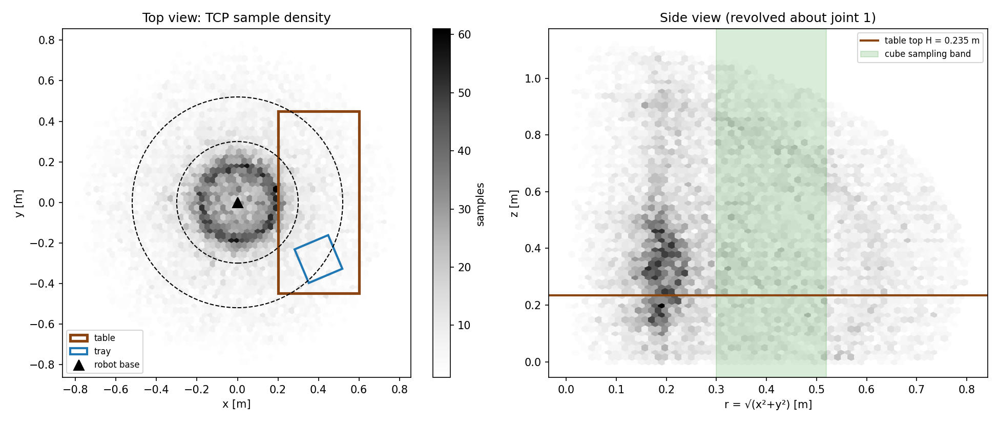
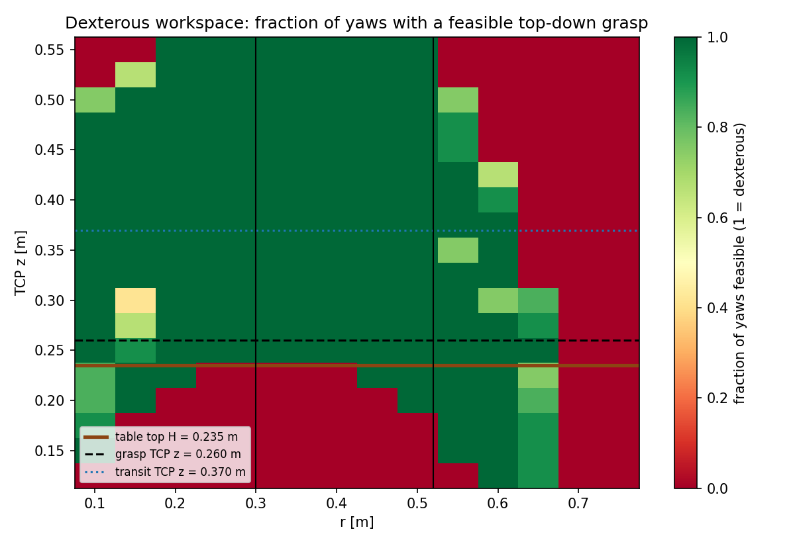
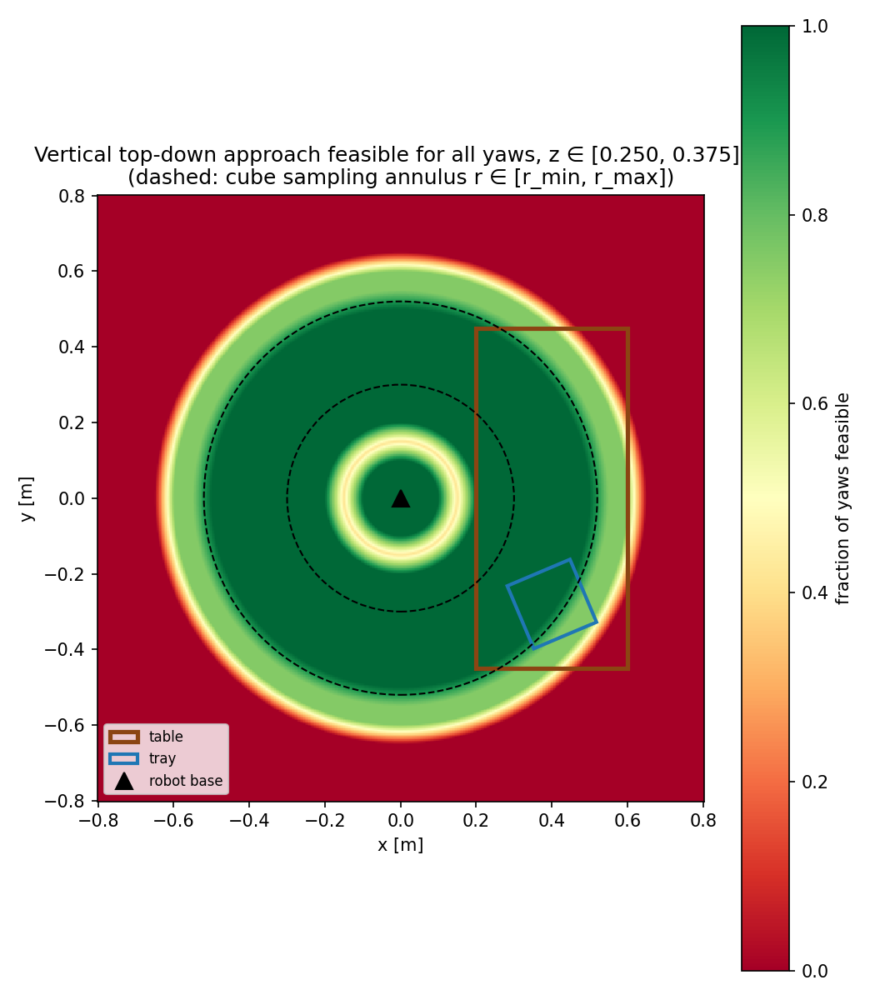
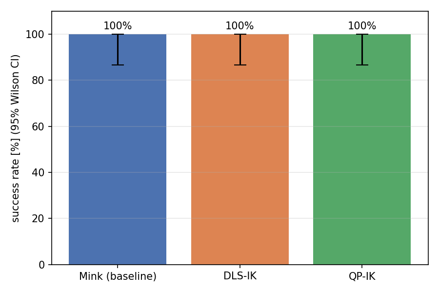
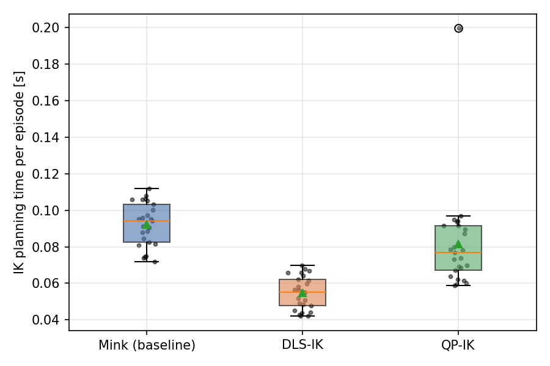
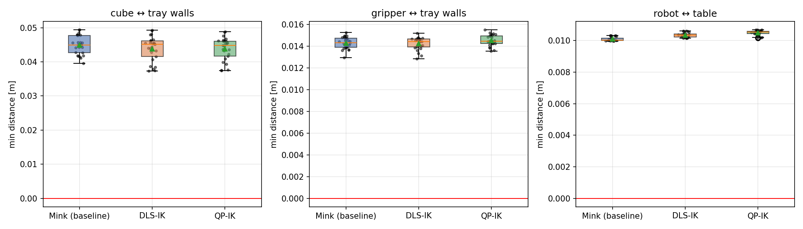
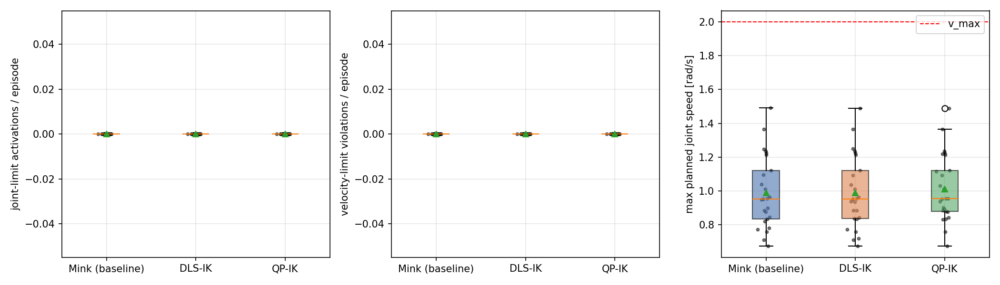
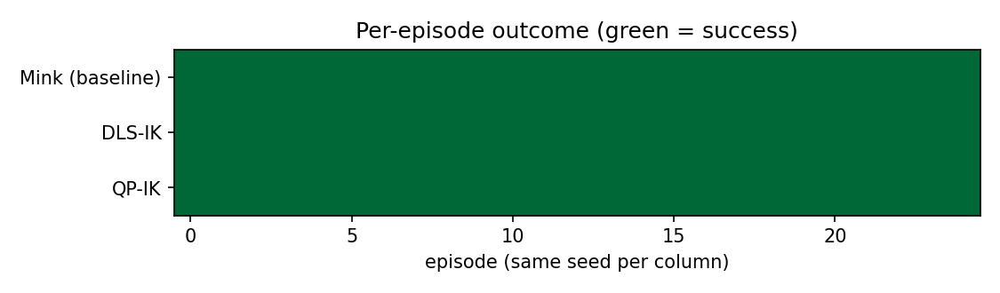

# Tutorial 4 – Pick and Place in MuJoCo with IK

**Name / Roll no.:** ⟨…⟩  **Repository:** ⟨GitHub link⟩  **IK library:** Mink – https://github.com/kevinzakka/mink

> Items marked ⟨…⟩ come from your own runs (`results/`). Delete this note before submitting.

## 1. Introduction and goals

A 6-DoF HEAL arm with a parallel-jaw gripper must pick a 5 cm cube placed at a random position and
yaw on a table and drop it into a tray. We (i) analyse the task and dexterous workspaces and design
the table from them, (ii) build a randomised, fully logged episode pipeline, (iii) solve IK with the
off-the-shelf library Mink, and (iv) replace it with our own Damped-Least-Squares (DLS) and
Quadratic-Programming (QP) IK, comparing all three on identical seeds.

## 2. Methods

### 2.1 Environment
*Scene* (`robot_descriptions/pick_place_scene.xml`): HEAL arm (kinematics and inertias from the
course model, base at the origin), primitive parallel gripper (two slide joints with position
actuators, friction 1.5, squeeze ≈ 6 N per pad), table, tray (inner 0.16 × 0.16 m, walls 6 cm, rotated
0.4 rad), and a 0.1 kg cube with a free joint. The TCP site sits between the pads, 1.5 cm above the fingertips.
Robot geoms do not collide with each other; table, tray and cube collide with the robot and each other.

*Control:* τ = qfrc_bias + K_p(q* − q) + b·q̇*, with K_p = (600, 600, 600, 300, 300, 200) N·m/rad.
Gravity and Coriolis effects are cancelled by `qfrc_bias`, and the model’s joint damping b = 55 N·m·s/rad
acts as the D-term. MuJoCo integrates that damping implicitly, so the loop stays stable at Δt = 2 ms.

### 2.2 Workspace analysis and table design
*Task workspace*: TCP positions from 30 000 uniformly sampled joint vectors (Fig. 1). Maximum reach
r = 0.80 m, z ∈ [0, 1.12] m. *Dexterous workspace*: a position counts as dexterous if a **top-down**
grasp is feasible for **all 12 tested yaws** in [−π, π). Joint 1 rotates the arm about the world z-axis,
so feasibility depends only on (r, z). We scanned a 14 × 18 (r, z) grid with DLS-IK, warm-starting each
height from the one above (continuation) and adding random restarts (Fig. 2).

Results: every yaw is feasible for z ≥ 0.25 m over r ∈ [0.10, 0.55] m. Below about 0.22 m the mid-radius
band (r ≈ 0.2–0.45 m) becomes infeasible, because the inclined wrist cannot point straight down that
close to the base. Over the whole vertical approach column (z = 0.25 … 0.375 m) all yaws remain
feasible for r ∈ [0.10, 0.50] m and ≥ 75 % up to 0.55 m (Fig. 3).

| Parameter | Symbol | Value | Rationale |
|---|---|---|---|
| Table length | L | 0.40 m (x = 0.20 … 0.60) | Front edge 0.20 m from the base clears the turret; far edge inside the 0.80 m task reach |
| Table width | W | 0.90 m (y = ±0.45) | Spans the dexterous annulus (r ≤ 0.52 m) on both sides of the arm |
| Table height | H | 0.235 m | Grasp TCP z = H + 0.025 = 0.26 m ≥ 0.25 m (lowest fully dexterous height, +1 cm margin); transit z = 0.37 m also fully dexterous |
| Cube sampling | r | [0.30, 0.52] m, yaw ∈ [−π, π) | Dexterous for the whole approach column; r ≥ 0.30 m keeps the arm off its base |
| Tray | — | centre (0.40, −0.28), r = 0.49 m | Inside the dexterous band at the place height (0.278 m) |

### 2.3 Episode generation
For episode i (seed = i), x and y are drawn uniformly on the table with a 5 cm edge margin. Samples
outside r ∈ [0.30, 0.52] m, or inside the tray keep-out box, are rejected; yaw is uniform in [−π, π).
The same seeds are used for all three IK methods. The phases are: approach (TCP at transit height
above the cube) → descend → close → lift → transit → lower into tray → open → retreat. Each phase is
a straight Cartesian line with minimum-jerk timing, discretised at 50 Hz, and IK is solved at every knot,
warm-started from the previous one. The resulting joint trajectory q*(t) is tracked by the controller.

*Collision avoidance between cube, gripper and tray.*
1. The transit height keeps the cube bottom and fingertips 5 cm above the tray walls.
2. After the lift, the cube’s yaw relative to the gripper is re-measured, and the place yaw is chosen
   so the cube lands aligned with the rotated tray, using the k·90° option with the least wrist rotation.
3. Before executing, the planner checks that the cube corners and the opened pads fit inside the tray
   (5 mm margin) and predicts the transit clearance from FK; if a check fails, it raises the transit
   height or tries another yaw.
4. During execution, contacts are monitored (cube–wall while carrying, gripper–wall, arm–table, arm–tray),
   and the signed distances from `mj_geomDistance` are logged.

The grasp yaw falls back to the other three symmetric yaws when IK fails for the first choice.

### 2.4 IK methods
All three use the same pose error e = [p_t − p; ε_ω], where ε_ω = 2·Log(q_t ⊗ q_c⁻¹) with hemisphere
correction (implemented with θ = 2·atan2(‖v‖, w), which equals 2·acos(w) but stays accurate for small
angles). They also share ẋ_d = K e with K·Δt = 0.8, the tolerances (1 mm, 0.01 rad) and the
iteration budget (200).

* **Mink:** `FrameTask` on the TCP site (position and orientation cost 1), `PostureTask` (cost 0.01),
  `ConfigurationLimit`, `VelocityLimit` (2 rad/s), with the DAQP solver.
* **DLS:** q̇ = (JᵀJ + λI)⁻¹Jᵀẋ_d + (I − (JᵀJ + λI)⁻¹JᵀJ)·α(q_rest − q), with λ = 10⁻³ and α = 0.05.
  Joint limits are only enforced by clipping, which is counted as a limit hit.
* **QP:** min ½ΔqᵀHΔq + cᵀΔq s.t. GΔq ≤ h, with H = (2/Δt²)(JᵀJ + (λ + μ)I) and
  c = −(2/Δt)Jᵀẋ_d − (2μ/Δt)q̇_null. G = [I; −I] encodes the joint limits, the per-iteration
  velocity bound |Δq| ≤ v_max·Δt, and the trajectory velocity bound |q + Δq − q_prev| ≤ v_max·Δt_knot.
  **Note:** expanding the tutorial’s cost gives c = −(2/Δt)Jᵀẋ_d. The notes state −(1/Δt), which
  would halve every step; this is verified numerically in `tests/test_ik_math.py`.

## 3. Results (25 episodes per method, identical seeds)

⟨paste `results/comparison/summary_table.md`⟩

| Method | Success | Plan time / ep [s] | IK iters / knot | Min clear cube–tray [m] | Limit hits | Vel. violations |
|---|---|---|---|---|---|---|
| Mink | ⟨⟩ | ⟨⟩ | ⟨⟩ | ⟨⟩ | ⟨⟩ | ⟨⟩ |
| DLS | ⟨⟩ | ⟨⟩ | ⟨⟩ | ⟨⟩ | ⟨⟩ | ⟨⟩ |
| QP | ⟨⟩ | ⟨⟩ | ⟨⟩ | ⟨⟩ | ⟨⟩ | ⟨⟩ |

Paired tests (`results/comparison/stats.md`): ⟨McNemar p-values, Wilcoxon p-values⟩.

 
 

*Kinematic pre-check (no physics):* planning all 25 seeds with DLS succeeded in 25/25 episodes, with
0 velocity violations, 0 joint-limit hits and a peak planned joint speed of 1.68 rad/s (limit 2 rad/s).
The median was 3.8 IK iterations per knot. Cubes far out (r ≳ 0.45 m) converge in about 1 iteration per
knot; 12 of the 25 episodes, with cubes at r ≈ 0.30–0.45 m, needed 10–15 iterations per knot, because the
straight-line approach from the home pose forces a larger wrist/elbow reconfiguration there.

## 4. Failure analysis and mitigations

⟨For each category that occurred: count per method, one screenshot from `results/logs/<ik>/failures/`, cause.⟩

| Category | Typical cause | Mitigation (implemented ✓ / proposed) |
|---|---|---|
| `ik_infeasible` | Cube near the edge of the dexterous band, or wrist at ±π | ✓ alternate grasp yaw (4 symmetric options); ✓ sampling restricted to the dexterous band; proposed: joint-space pre-positioning before the Cartesian approach |
| `grasp_failed` / `grasp_slip` | Yaw misalignment, low squeeze, fast lift | ✓ yaw from the settled cube; ✓ slow lift; proposed: force-closure check, higher pad friction |
| `collision_cube-tray_wall` | Transit too low or cube rotated in the hand | ✓ 5 cm transit clearance; ✓ re-measured in-hand yaw; ✓ fit check |
| `collision_arm-table` | Convex-hull link collision when reaching near the base | ✓ r ≥ 0.30 m; proposed: collision-aware IK (Mink `CollisionAvoidanceLimit`) |
| `place_missed` | Cube dropped from too high or bounced | ✓ release 1 cm above the floor; proposed: lower `place_gap` |
| QP velocity-bound non-convergence | Path demands q̇ > v_max (near singularity) | Slow the segment down (time-scaling) instead of failing |

## 5. Discussion and conclusions

⟨2–3 paragraphs from your numbers. Points worth discussing:⟩
* **Mink** is the fastest to integrate: tasks and limits are declarative, but the per-iteration QP
  setup on the full nv (including the cube and finger DoFs) adds overhead.
* **DLS** is the cheapest per iteration and robust near singularities thanks to λ, but it has no notion
  of limits; clipping and velocity violations show up in the logs. The damping λ trades accuracy for stability.
* **QP-IK** guarantees joint and velocity limits by construction, at the cost of a solver call per
  iteration. When the bound is active it may need more iterations, or fail instead of violating.
* Workspace-driven table design removed the class of infeasible top-down grasps entirely: no cube is
  ever sampled where a vertical approach is impossible.
* Future work: collision-aware IK, joint-space transit with RRT, closed-loop grasp verification
  with touch sensors.
